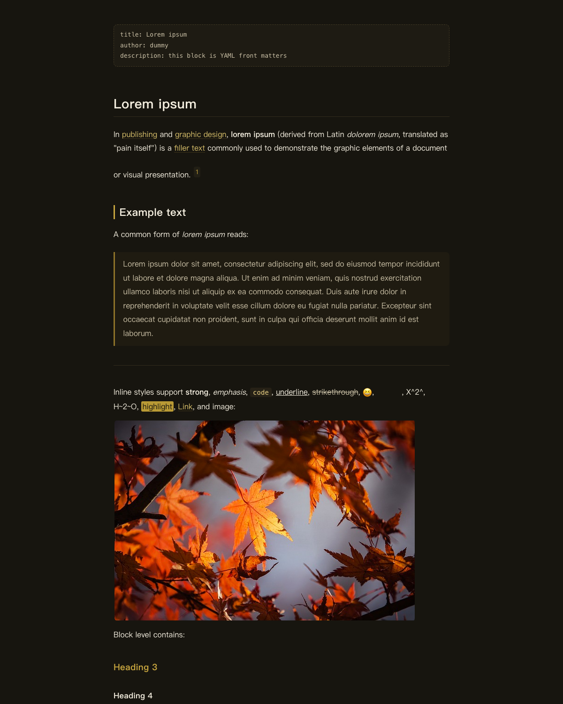
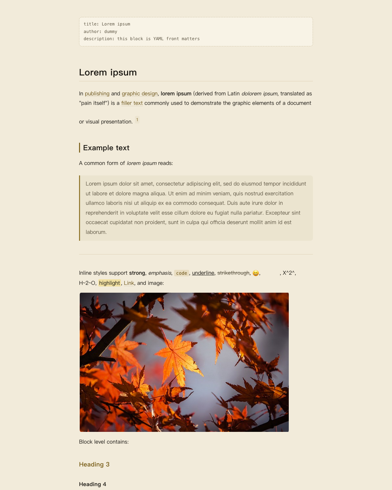
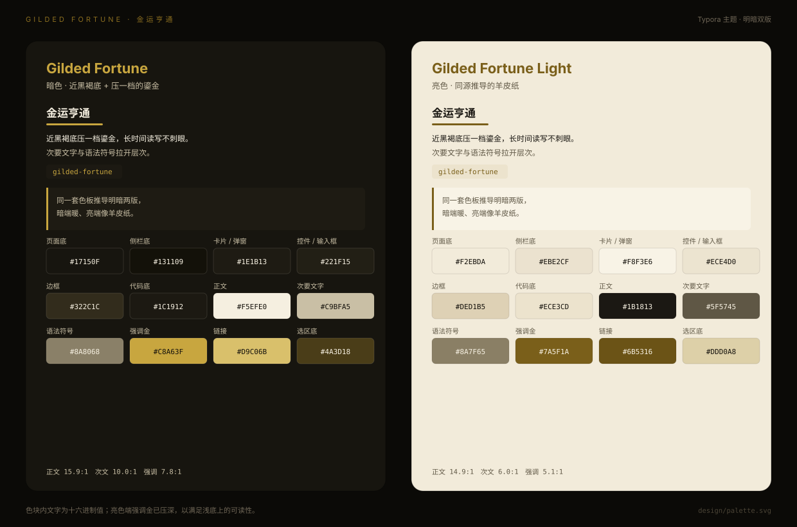

<p align="center"></p>

# Typora Gilded Fortune

English | [中文](README.zh.md)

**Gilded Fortune** is a dark and light theme pair for [Typora](https://typora.io): a near-black warm brown ground with a slightly desaturated gilded gold, plus a parchment light variant derived from the same palette. The colors are not ported from any third-party theme — they come from a five-elements "metal" fortune page the author built, and match the [Paseo version](https://github.com/mousebomb/paseo-gilded-fortune).

| Dark | Light |
|---|---|
|  |  |



## Install

### Script (macOS)

```bash
git clone https://github.com/mousebomb/typora-gilded-fortune.git
cd typora-gilded-fortune
bash install.sh
```

The script copies both CSS files and the `gilded-fortune/` asset folder into Typora's theme folder, moving any previous copy to the Trash so it stays recoverable. Use `bash install.sh --dry-run` to preview the changes.

### Manual

1. Typora → Preferences (`cmd+\``) → Appearance → **Open Theme Folder**
2. Copy `gilded-fortune.css`, `gilded-fortune-light.css` and the `gilded-fortune/` folder into it
3. Restart Typora and pick **Gilded Fortune** or **Gilded Fortune Light** from the Themes menu

> The CSS files must sit at the root of the theme folder; resources are pulled in through relative `@import`, so the folder has to stay next to them.

## Palette

| Role | Dark | Light |
|---|---|---|
| Page / body text | `#17150F` / `#F5EFE0` | `#F2EBDA` / `#1B1813` |
| Sidebar | `#131109` | `#EBE2CF` |
| Cards / dialogs | `#1E1B13` | `#F8F3E6` |
| Controls / inputs | `#221F15` | `#ECE4D0` |
| Borders | `#322C1C` | `#DED1B5` |
| Accent gold | `#C8A63F` | `#7A5F1A` |
| Links | `#D9C06B` | `#6B5316` |
| Code background | `#1C1912` | `#ECE3CD` |
| Selection | `#4A3D18` | `#DDD0A8` |

Measured WCAG contrast ratios (enforced by `npm test`):

| | Body / page | Muted / page | Accent / page | Inline code | Selected text |
|---|---|---|---|---|---|
| Dark | 15.9:1 | 10.0:1 | 7.8:1 | 10.2:1 | 10.0:1 |
| Light | 14.9:1 | 6.0:1 | 5.1:1 | 5.5:1 | 11.5:1 |

## Design notes

- **The dark theme needs a solid body background.** Typora computes `document.body`'s background brightness as `(299R+587G+114B)/256000` and treats anything below `0.5` as dark. A transparent background makes the sidebar, menus and dialogs flip to white.
- **Font size base lives on `html`; everything else uses `rem`.** This is Typora's own rule — hard-coded pixels break the font-size preference in the appearance panel.
- **Sans-serif throughout**, using the PingFang SC system stack. No bundled fonts, no remote fonts; works offline and behind restrictive networks.
- **Restrained syntax colors**: gold, olive, terracotta and parchment only, so code blocks do not fight the surrounding gold.
- **No "dark text on dark selection"**: text color, `--active-file-bg-color` and `--primary-color` are all kept at 4.5:1 or better, a bug hit while building the Paseo theme.
- **No forced first-line indent**; that stays a Typora preference.

## Layout

```
gilded-fortune.css            dark theme (menu label comes from the filename)
gilded-fortune-light.css      light theme
gilded-fortune/
  base.css                    structure shared by both themes
  codeblock.css               fence syntax highlighting (.cm-s-inner)
  sourcemode.css              source mode (.cm-s-typora-default)
  mermaid.css                 diagram containers
install.sh                    install into the local Typora theme folder
design/                       palette card and preview generators
test/theme.test.mjs           variable, contrast and brightness contract tests
```

## Development

```bash
npm test                 # contract and contrast tests (node:test, no dependencies)
npm run palette          # regenerate design/palette.svg
npm run preview          # render previews with Typora's official toolkit (needs Chrome)
```

Color changes: edit `:root` in the two theme files → `npm test` → `npm run palette` / `npm run preview`.

Previews use [typora/typora-theme-toolkit](https://github.com/typora/typora-theme-toolkit), the official debugging toolkit; it is cloned into `.cache/` and not committed.

## Compatibility

Developed and tested on macOS with Typora 1.14. The Windows/Linux unibody UI (megamenu) is styled but not verified item by item.

## License

MIT. The palette is derived from the author's own page, with no third-party theme colors involved.
