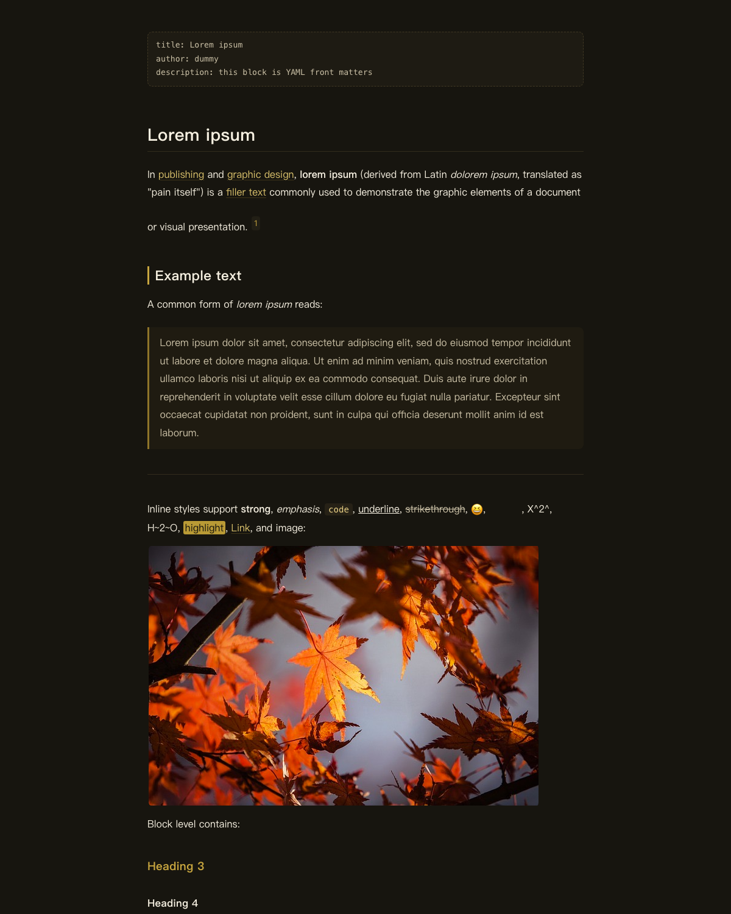
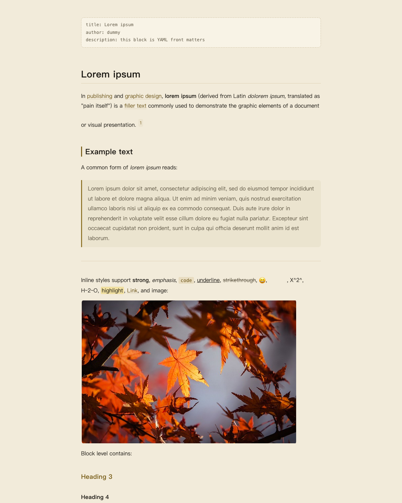
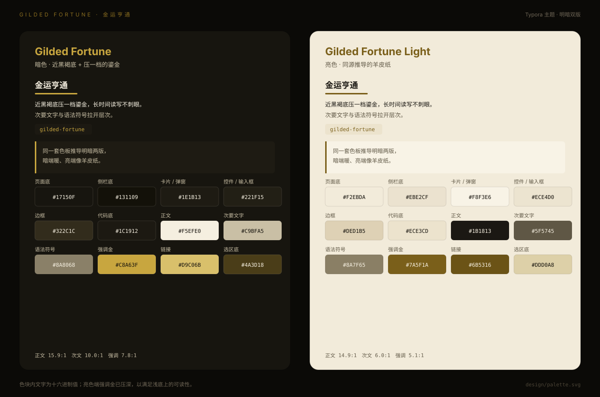

# Typora Gilded Fortune（金运亨通）

[English](README.md) | 中文

给 [Typora](https://typora.io) 写的 **金运亨通** 明暗双主题：近黑褐底配压一档的鎏金强调色，另有一套同源推导的羊皮纸亮色版。色板不是移植任何第三方主题，而是从作者自建的五行「补金」运势页推导，与 [Paseo 版](https://github.com/mousebomb/paseo-gilded-fortune) 同源，因此无上游色板版权依赖。

| 暗色 | 亮色 |
|---|---|
|  |  |



## 安装

### 脚本（推荐，macOS）

```bash
git clone https://github.com/mousebomb/typora-gilded-fortune.git
cd typora-gilded-fortune
bash install.sh
```

脚本会把两个 CSS 与 `gilded-fortune/` 资源夹拷进 Typora 主题目录；同名旧文件用 `trash` 移入废纸篓，可恢复。想先看会改什么：`bash install.sh --dry-run`。

### 手动

1. Typora → 偏好设置（`cmd+\``）→ 外观 → **打开主题文件夹**
2. 把 `gilded-fortune.css`、`gilded-fortune-light.css` 和 `gilded-fortune/` 文件夹一起拷进去
3. 重启 Typora，在「主题」菜单里选择 **Gilded Fortune** 或 **Gilded Fortune Light**

> 主题 CSS 必须放在主题文件夹的**根目录**，资源靠相对 `@import` 引用，所以文件夹要和 CSS 平级。

## 配色

| 用途 | 暗色 | 亮色 |
|---|---|---|
| 页面底 / 正文 | `#17150F` / `#F5EFE0` | `#F2EBDA` / `#1B1813` |
| 侧栏底 | `#131109` | `#EBE2CF` |
| 卡片 / 弹窗 | `#1E1B13` | `#F8F3E6` |
| 控件 / 输入框 | `#221F15` | `#ECE4D0` |
| 边框 | `#322C1C` | `#DED1B5` |
| 强调金 | `#C8A63F` | `#7A5F1A` |
| 链接 | `#D9C06B` | `#6B5316` |
| 代码底 | `#1C1912` | `#ECE3CD` |
| 选区底 | `#4A3D18` | `#DDD0A8` |

已验算的 WCAG 对比度（`npm test` 会守住）：

| | 正文/底 | 次文/底 | 强调/底 | 行内代码 | 选区文字 |
|---|---|---|---|---|---|
| 暗色 | 15.9:1 | 10.0:1 | 7.8:1 | 10.2:1 | 10.0:1 |
| 亮色 | 14.9:1 | 6.0:1 | 5.1:1 | 5.5:1 | 11.5:1 |

## 设计取舍

- **暗色主题的 body 必须是实底背景**。Typora 用 `document.body` 计算背景亮度 `(299R+587G+114B)/256000`，`< 0.5` 才当成暗色主题；写成透明或继承，侧栏、菜单、弹窗会翻成白色。
- **字号基准写在 `html`，其余全用 `rem`**。这是 Typora 官方要求，写死 px 会让偏好面板里的字号设置失效。
- **全无衬线**：正文与标题都用 PingFang SC 系统栈，不打包字体、不引外链，离线与国内网络都不受影响。
- **代码高亮不铺彩虹**：限定在金 / 橄榄 / 赤陶 / 米白四色系内，跟主题金同家族，避免正文与代码打架。
- **选中行不留深底深字**：`--active-file-bg-color` 与文字、`--primary-color` 两两之间都 ≥ 4.5:1，这是 Paseo 版踩过的坑。
- **不做首行缩进**：交给 Typora 偏好面板，主题不写死 `text-indent`。

## 目录

```
gilded-fortune.css            暗色主题（Typora 菜单名来自文件名）
gilded-fortune-light.css      亮色主题
gilded-fortune/
  base.css                    两套主题共用的结构样式
  codeblock.css               代码块语法高亮（CodeMirror .cm-s-inner）
  sourcemode.css              源码模式（.cm-s-typora-default）
  mermaid.css                 图表容器
install.sh                    装进本机 Typora
design/                       配色卡与预览图生成脚本
test/theme.test.mjs           变量完整性 + 对比度 + 明暗判型契约测试
```

## 开发

```bash
npm test                 # 契约与对比度测试（node:test，零依赖）
npm run palette          # 重新生成 design/palette.svg
npm run preview          # 用 Typora 官方 toolkit 渲染预览图（需要 Chrome）
```

改色流程：改两个主题文件里的 `:root` → `npm test` → `npm run palette` / `npm run preview`。

预览用的是 [typora/typora-theme-toolkit](https://github.com/typora/typora-theme-toolkit)（Typora 官方提供的调试工具链），克隆在 `.cache/` 下且不入库。

## 兼容性

在 macOS + Typora 1.14 上开发与测试；Windows/Linux 的 unibody 界面（megamenu）已补样式，但未逐项实测。

## License

MIT。色板由作者自建页面推导，无第三方主题色板依赖。
